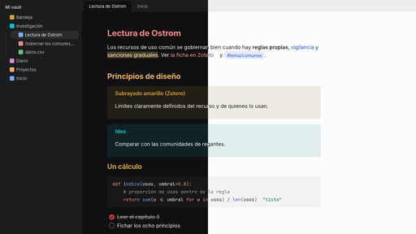
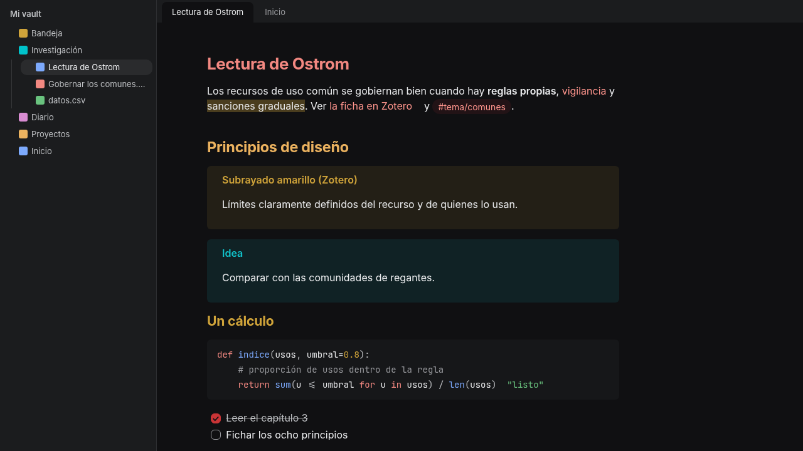
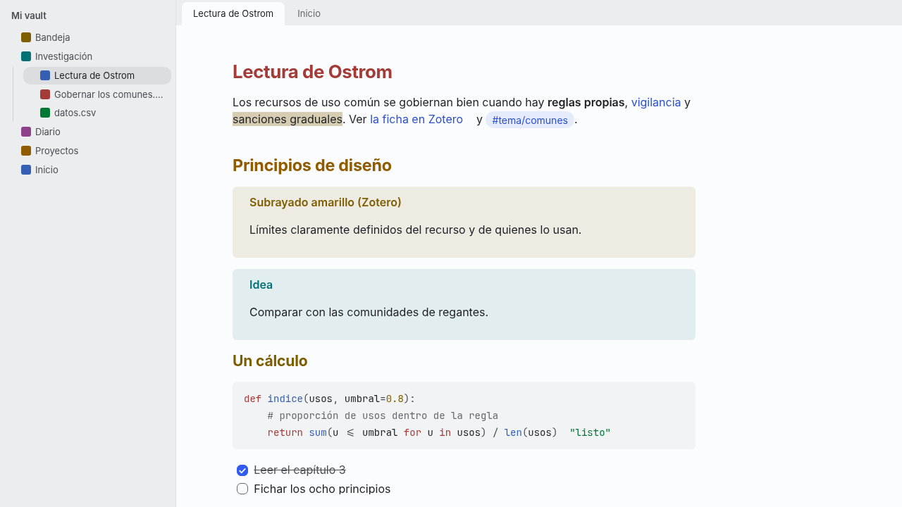

# Lliphi para Obsidian

Tema de Obsidian con los colores de [Lliphi](https://github.com/achalmed/lliphi), el tema de KDE Plasma derivado de
WhiteSur y Nothing: **Lliphi Oscuro** con el rojo de Nothing sobre neutros casi negros y **Lliphi Claro** con el azul de
WhiteSur, Inter para el texto y JetBrains Mono para el código. Sigue al modo claro u oscuro de Obsidian.



| Lliphi Oscuro | Lliphi Claro |
|---|---|
|  |  |

## Qué cambia

El tema solo redefine **variables de Obsidian 1.x**, sin tocar la estructura de la interfaz; por eso convive con
cualquier complemento que use las variables de la aplicación y no necesita Style Settings.

- **Neutros**: la escala `--color-base-00…100` de la que Obsidian deriva fondos, bordes y textos; la nota sobre el fondo
  de vista y las barras laterales sobre el de ventana, como en el escritorio.
- **Acento** por variante: rojo en el oscuro, azul en el claro (botones, casillas, selección, foco); los enlaces y las
  etiquetas en el tono de texto del acento. El selector de acento de Ajustes → Apariencia no lo cambia.
- **Ocho colores con nombre** (`--color-red` … `--color-pink` y sus `-rgb`) desde los colores de la terminal de Lliphi:
  de ellos salen las llamadas, los resaltados, los lienzos y los colores de los complementos que usan la paleta del tema.
- **Estados** (error, advertencia, éxito), avisos y tooltips con los tonos de Lliphi.
- **Encabezados de color**: h1 rojo, h2 naranja, h3 amarillo, h4 verde, h5 azul, h6 morado.
- **Código** con la misma tabla de sintaxis que los temas de Lliphi para VS Code y Zed: palabras clave en rojo, cadenas en
  verde, números en amarillo, funciones en azul, tipos en cian, comentarios atenuados.
- **Tipografía y forma**: Inter (o Noto Sans) en la interfaz y el texto, JetBrains Mono (Nerd Font si está) en el código;
  radios de 6, 10, 12 y 14 px; enlaces sin subrayado. Las fuentes no vienen con el tema: si no están instaladas, Obsidian
  usa las suyas. Las que elijas en Ajustes → Apariencia → Fuente mandan sobre las del tema.

### Llamadas de Zotero

Las plantillas de [Zotero Integration](https://github.com/mgmeyers/obsidian-zotero-desktop-connector) suelen escribir
cada anotación como una llamada con el color de Zotero en los metadatos:

```markdown
> [!quote|#ffd400] Subrayado
> el texto anotado
```

El tema pinta cada color de anotación de Zotero (amarillo, rojo, verde, azul, morado, magenta, naranja y gris) con el
color del tema del mismo nombre, en cualquier nota. Desde Obsidian 1.14 `--callout-color` es un color y no una terna
RGB: los fragmentos que todavía escriben `--callout-color: 255, 204, 0` dejan la llamada sin color.

## Instalar

Requiere Obsidian 1.14 o posterior (probado en 1.14.5).

Desde una versión publicada: crea `<vault>/.obsidian/themes/Lliphi/` y copia ahí `theme.css` y `manifest.json` de la
[última versión](https://github.com/achalmed/obsidian-lliphi/releases/latest), o instálalo con
[BRAT](https://github.com/TfTHacker/obsidian42-brat) («Add a beta theme», `achalmed/obsidian-lliphi`). Después: Ajustes →
Apariencia → Temas → **Lliphi**. Los demás temas instalados se quedan; para volver, se elige otro en el mismo menú.

Desde este repo:

```bash
./instalar.sh <ruta-del-vault>             # simula
./instalar.sh <ruta-del-vault> --aplicar   # copia a <vault>/.obsidian/themes/Lliphi/
```

## De dónde sale `theme.css`

`theme.css` **no se edita aquí**: lo genera Lliphi desde sus tokens de color (OKLCH) con su
[complemento `obsidian`](https://github.com/achalmed/lliphi/tree/main/complementos/obsidian), que lo escribe en
[`generado/obsidian`](https://github.com/achalmed/lliphi/tree/main/generado/obsidian) con pruebas de que cada color
existe en los tokens y de que las dos variantes definen las variables de Obsidian. Este repo solo lo trae y lo publica:

```bash
./traer.sh                          # simula: compara con el de la rama main de achalmed/lliphi
./traer.sh --aplicar                # lo reemplaza
./traer.sh <copia-de-lliphi>        # o desde una copia local de Lliphi (después de generar.py --aplicar)
```

Después de traerlo: `git diff`, sube `version` en `manifest.json` y publica una versión con `theme.css` y
`manifest.json` adjuntos.

## Familia

Lliphi para Obsidian es parte de una familia de complementos y un tema independientes que se complementan por
convenciones de datos (frontmatter y campos en línea), no por dependencias:
[Omitir carpetas](https://github.com/achalmed/obsidian-omitir-carpetas) ·
[Formatear Markdown](https://github.com/achalmed/obsidian-formatear-markdown) ·
[Tema de iconos](https://github.com/achalmed/obsidian-tema-de-iconos) ·
[Captura](https://github.com/achalmed/obsidian-captura) ·
[Notas tipadas](https://github.com/achalmed/obsidian-notas-tipadas) ·
[Tableros](https://github.com/achalmed/obsidian-tableros) ·
[Exportar a Super Productivity](https://github.com/achalmed/obsidian-super-productivity) · Lliphi.

Con Tema de iconos en «Del tema de Obsidian», los iconos del explorador toman los ocho colores de Lliphi.

## Licencia

El tema (`theme.css`, `screenshot.png` y `capturas/`), CC BY-SA 4.0 ([`licencia-cc-by-sa-4.0.txt`](licencia-cc-by-sa-4.0.txt)),
como todo lo que genera Lliphi; los guiones (`instalar.sh`, `traer.sh`), MIT ([`LICENSE`](LICENSE)).
